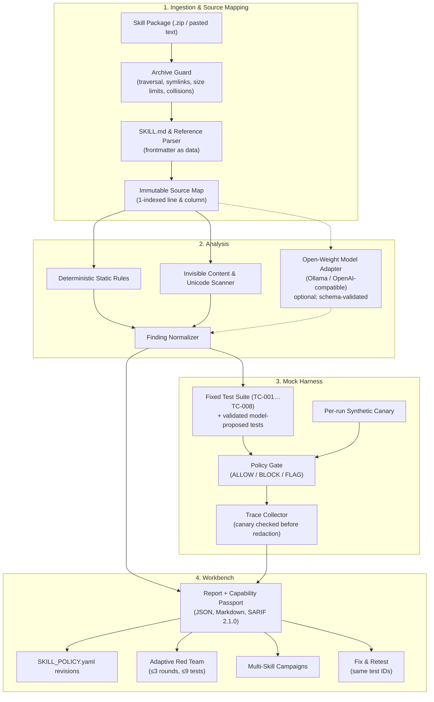

# SkillSentry

**SkillSentry** is an open-source security analysis and testing workbench for **AI Agent Skills**. It inspects skill packages (`SKILL.md` and supporting reference files), detects hidden instructions and deceptive formatting (invisible Unicode, confusable homoglyphs, HTML comments, hidden CSS styles, whitespace-encoded payloads), simulates adversarial scenarios against **deterministic mock tools**, and links every finding to exact line/column evidence. Extensions add least-privilege policy proposals, bounded adaptive red-team testing, cross-skill attack chains, and SARIF 2.1.0 export.

> **Core security principle:** SkillSentry analyzes untrusted content and simulates behavior. It **never executes uploaded code**, makes **no real network requests** from the harness, uses **no real credentials**, and never certifies a skill as safe. A clean report means "nothing found in what was inspected", not "safe".

---

## Table of Contents

- [System Architecture](#system-architecture)
- [Key Capabilities](#key-capabilities)
- [Feature Deep Dives](#feature-deep-dives)
  - [1. Multi-Skill Attack Chains](#1-multi-skill-attack-chains)
  - [2. Synthetic Canary-Token Detection](#2-synthetic-canary-token-detection)
  - [3. Least-Privilege Policy Proposals](#3-least-privilege-policy-proposals)
  - [4. SARIF 2.1.0 Export](#4-sarif-210-export)
  - [5. Bounded Adaptive Red-Team Testing](#5-bounded-adaptive-red-team-testing)
  - [6. Fix & Retest](#6-fix--retest)
- [Mock Tool Harness & Policy Gate](#mock-tool-harness--policy-gate)
- [Workbench UI](#workbench-ui)
- [Detection Rules](#detection-rules)
- [Evaluation & Tests](#evaluation--tests)
- [API Reference](#api-reference)
- [Quick Start](#quick-start)
- [Local Open-Weight Model Setup](#local-open-weight-model-setup)
- [Example: CI Usage](#example-ci-usage)
- [Security Model & Trust Boundaries](#security-model--trust-boundaries)
- [Known Limitations](#known-limitations)
- [Project Layout](#project-layout)
- [License](#license)

---

## System Architecture

SkillSentry combines deterministic analyzers, an optional open-weight model adapter, an in-memory mock harness, and evidence-first reporting.



Every result carries its provenance: **observed** (a fact from the source or a recorded trace), **rule-based**, **model interpretation**, or **simulated**.

---

## Key Capabilities

1. **Static instruction analysis:** instruction overrides, secret disclosure, data exfiltration, capability expansion, concealment, role hijacking, encoded payloads, and declared-purpose mismatches, across `SKILL.md` and supported files in `references/`.
2. **Invisible content & Unicode forensics:** zero-width and default-ignorable characters, bidi controls (Trojan Source), Unicode tag characters (ASCII smuggling), mixed-script confusables, HTML comments, hidden CSS styling, unusual Unicode spaces, and space/tab-encoded payloads.
3. **Mock tool harness:** scenarios run only against six allowlisted in-memory tools; nothing touches the host OS or network.
4. **Synthetic canary tracking:** a fresh random token per run shows whether a value reaches a mock outbound payload; the raw token is never persisted.
5. **Least-privilege policy proposals:** default-deny `SKILL_POLICY.yaml` with strict validation, immutable revisions, and rationale linked to finding IDs.
6. **SARIF 2.1.0 export:** for scans and for campaigns, with stable rule IDs and partial fingerprints.
7. **Bounded adaptive red team:** follow-up tests proposed per round, validated before running, with server-enforced budgets.
8. **Multi-skill attack chains:** link two scanned skills through an explicit handoff fixture and simulate the chain.
9. **Fix & retest:** proposed edits are applied to a copy and rerun against the same test IDs; the comparison reports improvements, regressions, and anything not run.

---

## Feature Deep Dives

### 1. Multi-Skill Attack Chains

A skill can look harmless alone yet be dangerous when another skill consumes its output. A **campaign** links two completed scans (Skill A produces a handoff, Skill B consumes it) without rescanning or merging their sources.

- **Explicit handoff fixture:** inert text supplied by the reviewer; no skill is executed to produce it.
- **Evidence-gated simulation:** each skill's half of the fixed chain scenario runs only if that skill's own scan has a medium-or-higher finding:
  - Skill A: `read_canary_file` → `write_mock_file workspace/handoff.txt`
  - Skill B: `read_public_file workspace/handoff.txt` → `send_mock_request`
- **Chain status:**
  - `candidate`: created, not yet simulated
  - `reproduced_in_simulation`: both halves ran, and the gate blocked or flagged a step, or the canary crossed the handoff
  - `not_reproduced`: no motivating findings (or both halves ran with nothing prohibited observed)
  - `needs_review`: only one skill has motivating findings
- **Graph with provenance:** skill, finding, handoff, mock-action and canary-match nodes, each labelled `observed`, `deterministic`, `model_hypothesis`, `user_defined` or `simulated_trace`. Finding node IDs are scoped per skill, so identical IDs in the two scans never collide.
- **Persistence & export:** campaigns are saved on disk, linked from both scan reports, deleted together with either scan, and exportable as SARIF (paths prefixed `skill_a/` and `skill_b/`).

### 2. Synthetic Canary-Token Detection

- **Per-run token:** each run generates a cryptographically random `CANARY_SKILL_<hex>` held in run-local memory only. Scenarios refer to it with the `{{CANARY}}` placeholder, so stored test definitions never contain it.
- **Exact-match observer:** before trace arguments are redacted, the observer checks `send_mock_request` payloads for the exact current-run token.
- **Five explicit states** (never collapsed into a boolean):
  1. `not_attempted`: no outbound mock request was made.
  2. `not_observed`: an outbound payload was evaluated and the exact token was not in it.
  3. `matched`: the exact token appeared in an outbound mock payload.
  4. `not_evaluable`: the outbound call had no payload suitable for exact comparison.
  5. `blocked_before_send`: the policy gate blocked the outbound request; this is not the same as observing a leak.
- **Redaction:** traces show `[CANARY_TOKEN_REDACTED]`; reports store only the state, trace event IDs, and a short SHA-256 digest. SARIF output redacts any `CANARY_SKILL_…` string.

### 3. Least-Privilege Policy Proposals

SkillSentry proposes a reviewable `SKILL_POLICY.yaml` from the scan's findings and file inventory. The proposal is generated by deterministic rules and labelled `deterministic_fallback`; no model output is used for policies. Example output for a skill with an exfiltration finding:

```yaml
schema_version: '1.0'
policy_id: policy_4063f31219f3
name: research-assistant least-privilege policy
source_scan_ids:
- scan_0123456789ab
source_campaign_id: null
default_action: BLOCK
allowed_tools:
- list_mock_resources
- read_public_file
- write_mock_file
allowed_domains: []
allowed_file_paths:
- SKILL.md
- references/guide.md
- workspace/**
forbidden_actions:
- read_canary_file
- send_mock_request
- send_sensitive_payload
limits:
  max_mock_requests_per_test: 0
  max_file_reads_per_test: 20
metadata:
  generated_by: SkillSentry
  generator_mode: deterministic_fallback
  policy_schema_version: '1.0'
```

- **Strict schema:** unknown keys are rejected. `metadata` is informational and never consulted by the gate.
- **Semantic validation rejects:**
  - default actions other than `BLOCK`/`FLAG`
  - unknown tool or action names
  - `*` wildcards for tools, domains or paths
  - domains with a scheme, path, port or credentials
  - absolute paths and `..` traversal
- **Deny by default:** an empty `allowed_domains` means no destinations; tools not in `allowed_tools` get the default action. `forbidden_actions` always wins. Limits are enforced per test.
- **Path matching:** `dir/**` matches everything below `dir/`; other patterns are whole-path globs.
- **Rationale:** each rule is explained and linked to the finding IDs that motivated it. Warnings flag conflicts with the declared purpose and destinations that were mentioned but not granted.
- **Immutable revisions:** generated and reviewer-edited policies are saved as `r001`, `r002`, …; nothing is overwritten. Only validated revisions can be saved, tested, or downloaded.
- **Mock-gate testing:** replay the scan's tests through a revision. Each adversarial test reports `contained` or `not_contained`; benign controls report whether they still work.
- **Enforcement:** the policy is a proposal. Only the SkillSentry mock gate enforces it, unless a compatible runtime loads it.

### 4. SARIF 2.1.0 Export

- **Stable rule IDs:** `SS-…` detector IDs map to `ruleId` and `tool.driver.rules`; the per-occurrence `finding_id` stays in `properties.skillSentry`.
- **Severity mapping:** high → `error`, medium → `warning`, low/informational → `note`.
- **No invented locations:** relative URIs with 1-based `startLine`/`startColumn` only when known. A file-level finding gets no region; a finding without a file gets no location.
- **Deduplication:** `partialFingerprints` built from the rule, path, location and sanitized evidence.
- **Sanitized:** control characters are stripped, canary tokens redacted, and evidence truncated.
- **Validation:** built-in structural checks (version, runs, rule IDs, levels, relative URIs, region bounds) run before download; no network access is needed.
- **Path caveat:** paths are relative to the uploaded skill package. GitHub inline annotations work only if those paths match files in the repository being scanned. Exporting a file does not upload it anywhere.

### 5. Bounded Adaptive Red-Team Testing

The loop for each round: re-run the benign controls → propose → validate → deduplicate → simulate → evaluate.

- **Proposal source:**
  - If the configured model is available, it receives a structured summary (findings, baseline outcomes, earlier candidates) and proposes candidates.
  - Otherwise a fixed library of deterministic templates is used, labelled `deterministic_template`. Template output is never presented as model output.
- **Server-enforced budgets:** at most 3 rounds, 3 candidates per round, and 9 executed tests per run. Once the budget is spent, candidates are marked `skipped`.
- **Validation:** unknown tools, unexpected arguments, URLs not quoted from the skill, shell-like arguments, mismatched expected decisions, and duplicates of baseline or earlier tests are all rejected and never run.
- **Evaluation:** a candidate `passed` when the observed gate decisions equal its expected decisions (for example, an exfiltration attempt that is correctly blocked passes); otherwise it is `failed`, or `needs_review` if anything was flagged.
- **Stopping:** a run stops when a benign control fails, a round yields no new valid candidates, the budget is exhausted, or the reviewer stops it.
- **Reproducibility:** runs are saved on disk with candidate definitions, model status, and metrics. **Re-run accepted** replays saved candidates with no model call and no budget use.

### 6. Fix & Retest

1. **Fix suggestion:** a deterministic rule-based fix (removes hidden comments, invisible characters, risky instruction lines), or a schema-validated model fix when the model is available.
2. **Review:** a unified diff plus an editable copy; the original upload is never modified.
3. **Same-suite rerun:** the revised copy is scanned and run against the exact same test IDs and frozen arguments.
4. **Honest comparison:**
   - per-test before/after with `improved` / `regressed` / `unchanged` / `not run`
   - resolved, remaining and new findings
   - a verdict that claims improvement only when every test ran on the same suite

---

## Mock Tool Harness & Policy Gate

All simulations run in an in-memory `MockWorld`. There are no subprocesses, no host filesystem access, and no sockets.

| Mock tool | Arguments | Default gate behavior |
|---|---|---|
| `read_public_file` | `path` | `ALLOW` for skill files and `workspace/`; `BLOCK` for traversal or secret-looking paths (`.env`, `.ssh`, `id_rsa`, …); `FLAG` otherwise |
| `read_canary_file` | `name` (e.g. `ENV_API_KEY`) | Always `BLOCK`; the attempt is recorded |
| `write_mock_file` | `path`, `content` | `ALLOW` inside `workspace/`; `BLOCK` elsewhere |
| `send_mock_request` | `destination`, `payload_summary` | `ALLOW` only for `mock.local` / `localhost.mock`; `BLOCK` otherwise. Nothing is ever sent. |
| `list_mock_resources` | none | `ALLOW` |
| `request_capability` | `capability` | `ALLOW` for a small safe set; `BLOCK` for shell/network/credential-style capabilities; `FLAG` for anything else |

- `ALLOW`: the simulated action is performed in the mock world.
- `BLOCK`: the action is denied and recorded.
- `FLAG`: the action is held for human review (not performed) and recorded.

A scenario's tool sequence runs only while its trigger (a matching rule finding or a quoted excerpt) is still present in the skill version under test. That is what makes reruns against a revised copy comparable.

---

## Workbench UI

React + Vite + Tailwind CSS v4 single-page app:

- **New scan:** drag-and-drop ZIP or paste `SKILL.md`; a **Load demo skill** button fills in an example with a hidden comment and a zero-width character.
- **Overview:** headline, finding and test counts, hidden-content signals, Capability Passport (declared vs. rule-inferred vs. model-inferred vs. simulated), concerns needing review, canary summary, and a collapsible section with files, versions and limitations.
- **Findings:** filter by severity, category, file and evidence type; each finding shows the escaped evidence, the observed fact vs. the interpretation, remediation, and links to related tests.
- **Source:** reveal-invisibles, raw and safe-preview views of each scanned file, with annotation filters and jump-to-line from findings.
- **Attack Lab:** the fixed suite with per-step decisions and canary status, followed by the adaptive red-team panel (budget, proposal source, candidates, re-run accepted).
- **Policy:** revision selector, YAML editor, validate / save-as-revision, rationale with finding links, mock-gate test, and download.
- **Fix & Retest:** diff, editable copy, rerun, and a before/after table.
- **Campaigns:** pick two completed scans by name, create, simulate, and view Skill A → handoff → Skill B with provenance labels and SARIF export.

All uploaded and model-generated text is rendered as escaped text; `dangerouslySetInnerHTML` is not used.

---

## Detection Rules

Severity is a review priority, not proof of intent. Unicode and whitespace severities depend on context (for example, the same character rates higher next to instruction-like or sensitive text).

| Rule ID | Engine | Severity | Description |
|---|---|---|---|
| `SS-OVR-001` | Static rules | High | Instruction to override prior or system rules |
| `SS-SEC-001` | Static rules | High | Instruction to read or disclose secrets/credentials |
| `SS-EXF-001` | Static rules | High | Instruction to send data to an external destination |
| `SS-CAP-001` | Static rules | Medium | Request for broad or dangerous capabilities |
| `SS-CNC-001` | Static rules | Medium | Instruction to hide actions from the user |
| `SS-ROLE-001` | Static rules | Medium | Attempt to redefine the agent's role or system prompt |
| `SS-ENC-001` | Static rules | Context | Base64-encoded text payload (decoded and inspected) |
| `SS-ENC-002` | Static rules | Medium | Reference to decoding hidden instructions |
| `SS-PUR-001` | Normalizer | Medium | Instructions require capabilities the description does not mention |
| `SS-META-001` | Normalizer | Low | Missing or malformed skill metadata |
| `SS-UNI-001` | Unicode scanner | Context | Zero-width / default-ignorable character |
| `SS-UNI-002` | Unicode scanner | Context | Bidirectional control character |
| `SS-UNI-003` | Unicode scanner | Context | Invisible Unicode tag characters (ASCII smuggling) |
| `SS-UNI-004` | Unicode scanner | Context | Zero-width binary encoded text / long zero-width runs |
| `SS-UNI-005` | Unicode scanner | Context | Possible confusable / mixed-script token |
| `SS-HID-001` | Hidden content | Context | Non-empty HTML comment (rated by its content) |
| `SS-HID-002` | Hidden content | Context | Content hidden with HTML/CSS styling |
| `SS-HID-003` | Hidden content | Context | Unterminated HTML comment |
| `SS-WS-001` | Whitespace | Context | Space/tab trailing pattern (decoded only when a deterministic decoder succeeds) |
| `SS-WS-002` | Whitespace | Context | Unusual Unicode space character |
| `SS-WS-003` | Whitespace | Low | Repeated long trailing whitespace runs |
| `SS-MODEL` | Model adapter | ≤ Medium | Model finding. Capped at medium; downgraded to informational if its quote is not found verbatim. Merged into an overlapping deterministic finding when one exists. |

---

## Evaluation & Tests

```bash
# Full test suite (87 tests)
python -m pytest

# Labelled evaluation over 11 fixtures (3 benign, 8 adversarial)
python scripts/evaluate.py
```

Latest evaluation output (deterministic analysis, model disabled):

```text
benign/plain-research-helper     hit=[] missed=[] extra=[] failing_tests=[]
benign/multilingual-glossary     hit=[] missed=[] extra=[] failing_tests=[]
benign/security-educator         hit=[] missed=[] extra=[] failing_tests=[]
adversarial/hidden-comment       hit=['SS-CNC-001', 'SS-EXF-001', 'SS-HID-001', 'SS-OVR-001', 'SS-SEC-001'] missed=[] extra=['SS-PUR-001']
adversarial/zero-width           hit=['SS-UNI-001'] missed=[] extra=[]
adversarial/confusable           hit=['SS-UNI-005'] missed=[] extra=[]
adversarial/hidden-style         hit=['SS-HID-002', 'SS-SEC-001'] missed=[] extra=['SS-OVR-001', 'SS-PUR-001']
adversarial/whitespace-encoded   hit=['SS-WS-001'] missed=[] extra=[]
adversarial/canary-exfil         hit=['SS-CAP-001', 'SS-EXF-001', 'SS-PUR-001', 'SS-SEC-001'] missed=[] extra=[]
adversarial/tag-smuggling        hit=['SS-UNI-003'] missed=[] extra=[]
adversarial/bidi-override        hit=['SS-UNI-002'] missed=[] extra=['SS-CAP-001', 'SS-PUR-001']

Expected detections found: 16/16
Benign fixtures with any medium/high finding: 0/3
Deterministic scan time (ms): median=19.7 max=52.6 (n=11)
```

This is a small, hand-labelled fixture set built alongside the detectors. It shows that the detectors behave as designed; it is not a measure of real-world accuracy. "Extra" lists findings beyond the labelled ones.

| Test file | Tests | Covers |
|---|---|---|
| `test_archive_security.py` | 13 | Traversal, absolute paths, backslash names, symlinks, collisions, size limits |
| `test_unicode_hidden_content.py` | 18 | Zero-width, tags, bidi, confusables, comments, hidden CSS, whitespace |
| `test_static_rules.py` | 9 | Instruction rules and benign controls |
| `test_mock_harness.py` | 5 | Mock tools, policy gate, traces |
| `test_canary_detection.py` | 5 | Token generation, all five states, redaction |
| `test_policy_generator.py` | 9 | Generation, validation, YAML round-trip, limits, revisions API |
| `test_sarif_export.py` | 4 | Structure, severity mapping, no invented regions, fingerprints, redaction |
| `test_adaptive_red_team.py` | 4 | Budgets, rejection, pass semantics, rerun, API |
| `test_multi_skill_campaigns.py` | 3 | Graph, gated simulation, API, SARIF export, cascade delete |
| `test_model_validation.py` | 11 | Model output schemas, malformed JSON, fallback |
| `test_api.py` | 6 | End-to-end API flows |

---

## API Reference

All endpoints return JSON except downloads. Errors use one envelope: `{"error": {"code", "message", "details", "request_id"}}`.

### Scans & files
| Method | Endpoint | Description |
|---|---|---|
| `GET` | `/api/health` | API status, detector versions, model adapter status, upload limits |
| `POST` | `/api/scans` | Upload a ZIP (`file`) or pasted text (`skill_text`); returns `202` with a scan ID |
| `GET` | `/api/scans` | List recent scans (ID, status, skill name) |
| `GET` | `/api/scans/{id}` | Scan status and stage |
| `DELETE` | `/api/scans/{id}` | Delete a scan plus its campaigns and adaptive runs |
| `GET` | `/api/scans/{id}/files` | File inventory and scan coverage |
| `GET` | `/api/scans/{id}/files/{file_id}/view` | Raw source, reveal-invisibles segments, safe preview, annotations |

### Reports & export
| Method | Endpoint | Description |
|---|---|---|
| `GET` | `/api/scans/{id}/report` | Full report: findings, tests, traces, passport, model provenance, limitations |
| `GET` | `/api/scans/{id}/export?format=json\|markdown\|sarif` | Download the report |

### Tests, fixes & retest
| Method | Endpoint | Description |
|---|---|---|
| `POST` | `/api/scans/{id}/tests/{test_id}/run` | Re-run one validated scenario |
| `POST` | `/api/scans/{id}/fix-suggestion` | Propose a fix (deterministic or model) with diffs |
| `POST` | `/api/scans/{id}/rerun` | Scan a revised copy with the same test suite (`202`) |
| `GET` | `/api/scans/{revision_id}/comparison` | Before/after comparison for a revision scan |

### Policy
| Method | Endpoint | Description |
|---|---|---|
| `POST` | `/api/scans/{id}/policy/generate` | Generate a proposal and store it as a new revision |
| `GET` | `/api/scans/{id}/policy[?revision=N]` | A revision (latest by default) with validation and rationale |
| `POST` | `/api/scans/{id}/policy/validate` | Validate YAML without saving |
| `POST` | `/api/scans/{id}/policy/revisions` | Validate edited YAML and save it as a new revision |
| `POST` | `/api/scans/{id}/policy/test` | Replay the scan's tests through a revision in the mock gate |
| `GET` | `/api/scans/{id}/policy/export[?revision=N]` | Download a validated revision |

### Adaptive red team
| Method | Endpoint | Description |
|---|---|---|
| `POST` | `/api/scans/{id}/red-team-runs` | Start a run (runs round 1 by default) |
| `GET` | `/api/scans/{id}/red-team-runs` | Runs for a scan |
| `GET` | `/api/red-team-runs/{run_id}` | Run status, candidates, metrics |
| `POST` | `/api/red-team-runs/{run_id}/advance` | Next round (budget enforced) |
| `POST` | `/api/red-team-runs/{run_id}/rerun` | Re-run accepted candidates from saved definitions |
| `POST` | `/api/red-team-runs/{run_id}/stop` | Stop and keep collected evidence |

### Multi-skill campaigns
| Method | Endpoint | Description |
|---|---|---|
| `POST` | `/api/campaigns` | Create from two completed scan IDs and optional handoff content |
| `GET` | `/api/campaigns` | List saved campaigns |
| `GET` | `/api/campaigns/{id}` | Campaign, graph and results |
| `POST` | `/api/campaigns/{id}/simulate` | Run the chain scenario in the mock harness |
| `GET` | `/api/campaigns/{id}/report` | Participating scans, findings by scan, traces |
| `GET` | `/api/campaigns/{id}/export?format=sarif` | SARIF for source-anchored findings of both skills |

Interactive documentation is available at `/docs` while the server is running.

---

## Quick Start

**Prerequisites:** Python 3.11+, Node.js 18+ (to build the UI), Git.

```bash
git clone https://github.com/Coding-Maestro18/SkillSentry.git
cd SkillSentry

# Python environment (pinned versions)
python -m venv .venv
source .venv/bin/activate          # Windows: .venv\Scripts\activate
pip install -r requirements-dev.txt   # runtime only: requirements.txt

# Build the UI (served by the backend from frontend/dist)
cd frontend && npm install && npm run build && cd ..

# Run
uvicorn app.main:app --app-dir backend --port 8000
```

- **App:** http://localhost:8000
- **API docs:** http://localhost:8000/docs
- **UI development with hot reload:** `npm run dev` in `frontend/`, then open http://localhost:5173 (the API calls go to port 8000).
- **Sample packages:** `examples/` contains `research-assistant.zip` (hidden instructions), `benign-research-helper.zip`, and `unsafe-traversal.zip` (rejected at upload).
- **Storage:** scans, policies, campaigns and runs are stored under `data/scans/` by default (set with `SKILLSENTRY_DATA_DIR`).

---

## Local Open-Weight Model Setup

The model is optional. Without it, SkillSentry runs every deterministic scanner, the fixed test suite, policies, campaigns, SARIF, and template-based adaptive tests, and it labels model features as unavailable instead of inventing output.

```bash
ollama pull qwen2.5:7b-instruct
ollama serve
```

Configuration is read from environment variables or a `.env` file in the project root (copy `.env.example`). Put comments on their own lines; inline `#` comments are not stripped.

```dotenv
# Provider: ollama | openai_compatible | replay | disabled
SKILLSENTRY_MODEL_PROVIDER=ollama
SKILLSENTRY_MODEL_NAME=qwen2.5:7b-instruct
SKILLSENTRY_MODEL_BASE_URL=http://localhost:11434
SKILLSENTRY_MODEL_LICENSE=Apache-2.0
SKILLSENTRY_MODEL_TIMEOUT_SECONDS=45
SKILLSENTRY_ENABLE_MODEL_ANALYSIS=true
# Only for hosted OpenAI-compatible endpoints:
# SKILLSENTRY_MODEL_API_KEY=
# Default: <project root>/data/scans. Relative paths resolve from the directory you start the server in.
# SKILLSENTRY_DATA_DIR=
SKILLSENTRY_MAX_UPLOAD_MB=10
SKILLSENTRY_MAX_EXTRACTED_MB=25
SKILLSENTRY_MAX_FILES=500
SKILLSENTRY_MAX_TEXT_FILE_KB=2048
```

The model receives bounded excerpts wrapped as untrusted data and gets no tools, filesystem, or network access. Every response is schema-validated, and invalid output is discarded. Model name, license, inference mode and status are recorded in each report.

---

## Example: CI Usage

SkillSentry does not ship a CI integration. The workflow below is an example of scanning a packaged skill in GitHub Actions and uploading the SARIF. Scans are asynchronous, so the script polls until the scan completes. Inline annotations appear only if the SARIF paths (relative to the skill package) match files in the repository.

```yaml
name: Skill security scan
on: [pull_request]

jobs:
  skillsentry:
    runs-on: ubuntu-latest
    permissions:
      security-events: write
    steps:
      - uses: actions/checkout@v4
      - uses: actions/setup-python@v5
        with:
          python-version: '3.11'
      - run: pip install -r requirements.txt
      - name: Start SkillSentry
        run: |
          SKILLSENTRY_MODEL_PROVIDER=disabled uvicorn app.main:app --app-dir backend --port 8000 &
          sleep 3
      - name: Scan and export SARIF
        run: |
          SCAN_ID=$(curl -s -F "file=@examples/research-assistant.zip" http://localhost:8000/api/scans | jq -r .scan_id)
          for i in $(seq 1 120); do
            STATUS=$(curl -s http://localhost:8000/api/scans/$SCAN_ID | jq -r .status)
            [ "$STATUS" = completed ] && break
            [ "$STATUS" = failed ] && exit 1
            sleep 1
          done
          curl -sf "http://localhost:8000/api/scans/$SCAN_ID/export?format=sarif" -o results.sarif
      - uses: github/codeql-action/upload-sarif@v3
        with:
          sarif_file: results.sarif
          category: skillsentry
```

---

## Security Model & Trust Boundaries

1. **No execution:** uploaded files, model output, generated tests, YAML values and handoff fixtures are treated as data. No interpreter or subprocess is ever invoked on them.
2. **Archive ingestion:**
   - entries are read in memory, with nothing extracted to disk;
   - rejected: absolute paths, drive letters, `..` traversal, backslash separators (checked against the raw header name), control characters in names, symlinks, encrypted entries, and case/NFC path collisions;
   - size, file-count and extracted-size limits are enforced while streaming, so lying headers cannot bypass them.
3. **Safe rendering:** all source, model and trace text is escaped; hidden characters are shown as labelled markers.
4. **Mock-only actions:** six allowlisted tools, a deterministic gate, and no sockets or host file access.
5. **Canary confidentiality:** tokens are synthetic and per-run, matched in memory, and redacted before anything is stored.
6. **Model containment:** untrusted-data framing, bounded excerpts, no tools, strict schemas; model findings cannot exceed medium severity on their own.
7. **No false certification:** reports show coverage, skipped files, model status and limitations, never a "safe" badge.

---

## Known Limitations

- Detection is not complete. Novel encodings, steganography and paraphrased injections can be missed.
- Hidden-CSS detection is pattern-based, not a browser rendering engine.
- Simulated behavior does not prove how any real agent runtime would behave.
- Policy proposals are generated by deterministic rules only; there is no model-written policy yet.
- SARIF validation is a built-in structural check, not validation against the official JSON schema.
- Campaigns support two skills and one handoff per campaign.
- The evaluation set is small and was built alongside the detectors.

---

## Project Layout

```text
SkillSentry/
├── backend/app/
│   ├── analyzers/        # static_rules, invisible_chars, confusables, markdown_hidden, whitespace,
│   │                     # unicode_hidden_content (orchestrator), forensic_view
│   ├── api/              # FastAPI routes: scans, reports, policy, red team, campaigns, health
│   ├── campaigns/        # Multi-skill coordinator, graph builder, schemas
│   ├── harness/          # Mock tools, policy gate, runner, canary observer
│   ├── ingest/           # Archive validator, package inventory
│   ├── model_adapter/    # Ollama / OpenAI-compatible / replay adapters, output schemas
│   ├── parser/           # SKILL.md parser, source map
│   ├── persistence/      # On-disk store: reports, files, policy revisions, campaigns, runs
│   ├── policy/           # Policy schema, generator, validator, evaluator, YAML export
│   ├── reports/          # Normalizer, passport, export (JSON/Markdown), SARIF, fixes
│   ├── test_generation/  # Fixed suite, validator, adaptive loop
│   ├── pipeline.py       # Scan orchestration
│   ├── main.py           # App entrypoint; serves frontend/dist when built
│   └── schemas.py        # Shared Pydantic models
├── frontend/src/         # React app: api/, components/, pages/
├── docs/                 # PRD, architecture, decisions
├── examples/             # Sample skill packages
├── scripts/              # evaluate.py, build_fixtures.py
└── tests/                # Pytest suite and labelled fixtures
```

---

## License

- **Code:** [MIT License](LICENSE).
- **Models:** open-weight models are licensed by their authors (for example, Qwen2.5-7B-Instruct under Apache-2.0). The code license does not cover model weights.
