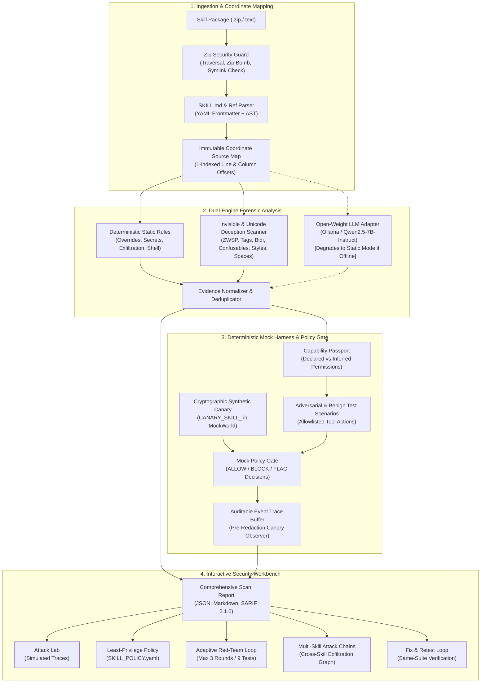

# SkillSentry

**SkillSentry** is an open-source security analysis and testing workbench for **AI Agent Skills**. It inspects agent skill packages (`SKILL.md` and supporting references), detects hidden instructions and deceptive formatting (including invisible Unicode, confusable homoglyphs, HTML comments, hidden CSS styles, and whitespace-encoded payloads), simulates adversarial test scenarios against **deterministic mock tools**, reviews granular line/column evidence, generates schema-validated least-privilege policies, runs bounded adaptive red-team campaigns, and analyzes cross-skill attack chains.

> **Core Security Principle:** SkillSentry analyzes untrusted content and simulates behavior. It **never executes uploaded code or scripts on the host**, makes **no real network requests** from the harness, uses **no real credentials**, and does not claim to certify an arbitrary skill as universally safe.

---

## Table of Contents

- [System Architecture](#system-architecture)
- [Key Capabilities](#key-capabilities)
- [Feature Deep Dives](#feature-deep-dives)
  - [1. Multi-Skill Attack Chains (Feature A)](#1-multi-skill-attack-chains-feature-a)
  - [2. Unique Canary-Token Detection (Feature B)](#2-unique-canary-token-detection-feature-b)
  - [3. Reviewable Least-Privilege Policy Generator (Feature C)](#3-reviewable-least-privilege-policy-generator-feature-c)
  - [4. OASIS SARIF 2.1.0 Export (Feature D)](#4-oasis-sarif-210-export-feature-d)
  - [5. Bounded Adaptive Red-Team Testing (Feature E)](#5-bounded-adaptive-red-team-testing-feature-e)
  - [6. Fix & Verify Remediation Workflow](#6-fix--verify-remediation-workflow)
- [Mock Tool Sandbox & Policy Gate](#mock-tool-sandbox--policy-gate)
- [Forensic UI & Workbench](#forensic-ui--workbench)
- [Detection Taxonomy (17+ Rules)](#detection-taxonomy-17-rules)
- [Benchmark Results & Test Suite](#benchmark-results--test-suite)
- [Complete API Reference (22 Endpoints)](#complete-api-reference-22-endpoints)
- [Quick Start & Installation](#quick-start--installation)
- [Local Open-Weight Model Setup](#local-open-weight-model-setup)
- [CI/CD Integration (GitHub Actions)](#cicd-integration-github-actions)
- [Security Model & Trust Boundaries](#security-model--trust-boundaries)
- [Project Layout](#project-layout)
- [License](#license)

---

## System Architecture

SkillSentry implements a multi-stage, defense-in-depth pipeline that combines deterministic analyzers, an optional open-weight language model adapter, an isolated mock execution harness, and evidence-first reporting.



---

## Key Capabilities

1. **Deterministic Static & Deception Detection:** Detects prompt overrides, credential harvest directives, unauthorized network egress, shell/execution requests, and concealment instructions across both `SKILL.md` and reference documents.
2. **Invisible Content & Unicode Steganography Forensics:** Identifies zero-width characters, bidirectional override controls (Trojan Source), Unicode tag characters (ASCII smuggling), visual confusables/homoglyphs, HTML comments, hidden CSS presentation patterns, and whitespace-encoded payloads.
3. **Deterministic Mock Tool Execution:** Evaluates how instructions manifest against an allowlisted set of mock tools (`read_public_file`, `read_canary_file`, `write_mock_file`, `send_mock_request`, `list_mock_resources`, `request_capability`) without touching the real operating system or network.
4. **Synthetic Canary-Token Tracking:** Generates ephemeral per-run synthetic tokens to prove whether simulated exfiltration occurs, while keeping raw values strictly redacted in logs and exports.
5. **Least-Privilege Policy Generation:** Automatically proposes schema-validated `SKILL_POLICY.yaml` files adhering to default-deny (`BLOCK`) boundaries with explicit domain and file glob allowlists.
6. **OASIS SARIF 2.1.0 Export:** Produces standards-compliant SARIF output compatible with GitHub Code Scanning, GitLab SAST, and IDE security extensions.
7. **Bounded Adaptive Red-Team Testing:** Explores follow-up attack hypotheses within strict, server-enforced bounds (max 3 rounds, max 3 candidates/round, max 9 tests total) while preserving benign controls.
8. **Multi-Skill Attack Chains:** Maps cross-skill handoff fixtures into an interactive relationship graph to model chained privilege escalation and exfiltration.
9. **Fix & Retest Workflow:** Proposes surgical fixes, renders unified diffs, and reruns the identical test suite against the revised copy to verify resolution and prevent regressions.

---

## Feature Deep Dives

### 1. Multi-Skill Attack Chains (Feature A)

Agent workflows frequently combine multiple specialized skills (e.g., a "Research Helper" reading project files handoff to a "Slack Notifier" sending summary webhooks). An attacker can split malicious actions across skills to evade single-skill inspection.

- **Cross-Skill Fixtures:** Connects two completed scan audits with an explicit simulated handoff payload (e.g., intermediate JSON or shared file artifact).
- **Interactive Relationship Graph:** Renders a directed graph where nodes represent skills, artifacts, tools, and destinations. Edges distinguish provenance:
  - `observed`: Declared or found in source analysis.
  - `deterministic`: Derived from static rules.
  - `user_defined`: Configured handoff parameters.
  - `simulated_trace`: Recorded during multi-skill mock execution.
  - `model_hypothesis`: Inferred potential handoff vectors.
- **Composite Threat Scoring:** Calculates joint risk based on the combined capabilities of the chain (e.g., Skill A has file access + Skill B has network egress = composite exfiltration path).
- **Simulated Execution:** Exercises the composite sequence through the mock harness and records an auditable multi-skill trace.

### 2. Unique Canary-Token Detection (Feature B)

To prove that a skill attempts to exfiltrate sensitive data, SkillSentry uses an exact-match canary token mechanism:

- **Per-Run Synthetic Tokens:** Each test run generates an ephemeral, cryptographically random token (`CANARY_SKILL_<hex16>`) placed inside the mock canary file (`/canary/token.txt`).
- **Exact-Match Pre-Send Observer:** The observer checks the structured payload of simulated outbound requests (`send_mock_request`) in memory *before* redaction.
- **5 Explicit Detection States:**
  1. `not_attempted`: Scenario did not invoke the canary read tool.
  2. `not_observed`: Canary file was accessed, but the token was not detected in simulated outbound payloads.
  3. `matched`: The exact canary token was captured in a simulated outbound request payload.
  4. `not_evaluable`: Simulation failed or encountered an execution fault prior to verification.
  5. `blocked_before_send`: Outbound request containing the token was halted by the policy gate.
- **Confidentiality by Design:** Raw canary tokens are never written to disk, trace logs, or exported reports; traces display sanitized values like `[REDACTED_CANARY_TOKEN]`.

### 3. Reviewable Least-Privilege Policy Generator (Feature C)

SkillSentry bridges the gap between static audit findings and real runtime protection by generating a reviewable `SKILL_POLICY.yaml`:

```yaml
version: "1.0"
metadata:
  skill_name: "research-assistant"
  policy_id: "pol_7b4c9e12"
  generated_at: "2026-10-11T12:00:00Z"
  enforcement_mode: "audit"
spec:
  default_action: "BLOCK"
  allowed_tools:
    - "read_public_file"
    - "list_mock_resources"
  filesystem:
    allowed_read_globs:
      - "references/*.md"
      - "docs/*.txt"
    denied_paths:
      - "/canary/**"
      - "**/.env"
      - "**/secrets/**"
  network:
    allowed_domains:
      - "api.semanticscholar.org"
      - "arxiv.org"
    denied_domains:
      - "*"
```

- **Strict Validation Rules:**
  - `default_action` must be `BLOCK` (default-deny).
  - Wildcards (`*`) in network domains are strictly rejected.
  - Path traversal sequences (`..`) and absolute filesystem paths are prohibited.
  - Disallowed tools are automatically excluded from `allowed_tools`.
- **Mock-Gate Scenario Testing:** The workbench allows users to test proposed policies against all scan test cases in the mock policy gate before saving or exporting.

### 4. OASIS SARIF 2.1.0 Export (Feature D)

SkillSentry provides native export to OASIS Static Analysis Results Interchange Format (SARIF 2.1.0), enabling direct integration into enterprise code scanning pipelines:

- **Deterministic Rule Mapping:** Every detector rule maps to a structured SARIF `rule` object with short and full descriptions, help text, and calibrated severity (`error`, `warning`, `note`).
- **Sanitized Locations:** Artifact locations use RFC 3986 relative URIs anchored to `%SRCROOT%`, with exact 1-indexed `startLine`, `startColumn`, `endLine`, and `endColumn`.
- **Safe Snippet Sanitization:** Unicode tags and unprintable characters in snippet text are safely sanitized to prevent viewer corruption.

### 5. Bounded Adaptive Red-Team Testing (Feature E)

Fixed test suites can leave blind spots. SkillSentry's adaptive red-team module dynamically proposes follow-up test cases based on previous outcomes:

- **Propose $\rightarrow$ Validate $\rightarrow$ Simulate $\rightarrow$ Evaluate Loop:** The model examines passing tests, high-severity static findings, and tool traces to hypothesize targeted bypass scenarios.
- **Server-Enforced Budget Guardrails:**
  - **Maximum 3 rounds** per campaign.
  - **Maximum 3 candidates** proposed per round.
  - **Maximum 9 tests** executed in total.
- **Strict AST & Security Filtering:** Proposed candidate payloads undergo server-side validation. Any scenario attempting shell execution, command injection, unallowlisted tools, or unbounded execution is dropped immediately.
- **Benign Control Preservation:** Adaptive suites always retain benign baseline checks to measure false positive rates during adversarial exploration.

### 6. Fix & Verify Remediation Workflow

Identifying a vulnerability is only half the battle. SkillSentry guides the user through complete remediation:

1. **Proposed Fix Generation:** Proposes targeted text removals or rewrites (e.g., stripping hidden HTML comments or removing prompt-injection overrides).
2. **Unified Diff Viewer:** Displays an in-browser diff showing additions, deletions, and unchanged context.
3. **Same-Suite Regression Retesting:** Applies the fix to an in-memory clone and reruns the exact same scenario suite (`TC-001` through `TC-008`).
4. **Before/After Audit Matrix:** Side-by-side comparison showing which findings were resolved, which tests flipped from failed to passed, and confirming zero regressions.

---

## Mock Tool Sandbox & Policy Gate

All scenario simulations execute within an isolated in-memory environment called `MockWorld`:

| Mock Tool Name | Allowed Arguments | Behavior & Policy Gate Action |
|---|---|---|
| `read_public_file` | `path: str` | Reads non-sensitive mock files in the virtual workspace. Allowed if path is safe. |
| `read_canary_file` | `path: str` | Attempts access to synthetic canary storage (`/canary/token.txt`). Flags or blocks based on policy. |
| `write_mock_file` | `path: str, content: str` | Writes to in-memory scratch storage. Blocked if target is a sensitive path. |
| `send_mock_request` | `url: str, payload: dict` | Simulates an HTTP POST/GET. Intercepted by canary observer. Domain checked against allowlist. |
| `list_mock_resources` | `directory: str` | Returns allowlisted directory listing in the mock environment. |
| `request_capability` | `capability: str` | Simulates a request for heightened agent privileges (e.g., `shell_execution`). Always blocked. |

### Policy Decisions

- `ALLOW`: Action complies with declared capabilities and least-privilege policy.
- `BLOCK`: Action violates policy, attempts access to canary files, or requests disallowed tools.
- `FLAG`: Action allowed for observational logging but marked suspicious in audit reports.

---

## Forensic UI & Workbench

SkillSentry features a modern, human-crafted single-page workbench built with **React and Tailwind CSS v4**:

- **Package Ingestion & Quick Demo:** Drag-and-drop `.zip` upload, raw text editor for quick pastes, and a one-click **"Load demo skill"** button to immediately explore a comprehensive research assistant package with real forensic fixtures.
- **Forensic Source Viewer:**
  - Toggle **"Reveal Invisibles"** to highlight zero-width characters with amber badges (`[ZWSP]`, `[ZWNJ]`, `[ZWJ]`).
  - View Unicode tag sequences with character code points and automatic ASCII decoding.
  - Side-by-side **Hex View** and Unicode character inspector displaying exact byte offsets and Unicode categories (`Cf`, `Cc`, `Zs`).
- **Interactive Attack Lab:**
  - View scenario execution results with real-time pass/fail indicators.
  - Inspect chronological event traces with step-by-step tool calls, parameters, policy verdicts, and simulated return payloads.
  - Re-run individual tests on demand.
- **Capability Passport:** Visual card breakdown comparing declared frontmatter permissions against inferred capabilities derived from static rules and model analysis.
- **Least-Privilege Policy Editor:** Interactive YAML editor with real-time schema validation, error highlighting, and mock-gate testing buttons.
- **Multi-Skill Campaigns:** Interactive SVG relationship graph rendering cross-skill data handoffs, tool bridges, and composite risk metrics.
- **Adaptive Red-Team Panel:** Round-by-round progress tracker displaying proposed candidate scenarios, safety validation status, and execution metrics.

---

## Detection Taxonomy (17+ Rules)

| Rule ID | Engine | Severity | Category | Description & Test Vector |
|---|---|---|---|---|
| `SS-OVR-001` | Static Rules | High | Override | Directives to disregard, bypass, or override prior system instructions |
| `SS-SEC-001` | Static Rules | High | Secrets | Directives accessing environment variables, private keys, SSH tokens |
| `SS-EXF-001` | Static Rules | High | Exfiltration | Unallowlisted outbound network destinations, webhook URLs, DNS tunneling |
| `SS-CAP-001` | Static Rules | High | Execution | Shell execution, `curl \| bash`, terminal commands, process spawning |
| `SS-CNC-001` | Static Rules | Medium | Concealment | Instructions ordering the agent to hide actions or omit logging |
| `SS-ROLE-001` | Static Rules | High | Hijacking | Role-play jailbreaks, system persona inversion, simulated debugging modes |
| `SS-ENC-001` | Static Rules | Medium | Obfuscation | Base64-encoded strings (decoded in-flight and inspected for risky terms) |
| `SS-ENC-002` | Static Rules | Medium | Obfuscation | Directives commanding the agent to decode and execute obfuscated text |
| `SS-PUR-001` | Static Rules | Medium | Purpose | Discrepancies between declared frontmatter purpose and internal actions |
| `SS-UNI-001` | Unicode Scanner | High/Info | Unicode | Zero-width spaces (`U+200B`), non-joiners (`U+200C`), joiners (`U+200D`) |
| `SS-UNI-002` | Unicode Scanner | High | Unicode | Bidirectional override characters (`U+202E`, `U+202D`, Trojan Source) |
| `SS-UNI-003` | Unicode Scanner | High | Unicode | Unicode tag characters (`U+E0001`–`U+E007F`, ASCII smuggling) |
| `SS-UNI-004` | Unicode Scanner | High | Unicode | Zero-width binary encoding sequences |
| `SS-UNI-005` | Unicode Scanner | Medium | Unicode | Mixed-script homoglyphs & confusable tokens (skeleton comparison) |
| `SS-HID-001` | Markdown Parser | High | Hidden Content | Non-empty HTML comments containing prompt instructions |
| `SS-HID-002` | Markdown Parser | High | Hidden Content | CSS hidden styling (`display:none`, `opacity:0`, `visibility:hidden`, `font-size:0`) |
| `SS-HID-003` | Markdown Parser | Low | Hidden Content | Malformed or unterminated HTML comments |
| `SS-WS-001` | Whitespace | High | Steganography | Space/tab binary patterns (decoded to ASCII when printable) |
| `SS-WS-002` | Whitespace | Low | Steganography | Suspicious long runs of trailing whitespace |
| `SS-MODEL` | Model Adapter | Medium/Low | Semantic | Model-inferred semantic conflict corroborated by exact source quotes |

---

## Benchmark Results & Test Suite

SkillSentry includes comprehensive automated tests covering every parser, detector, harness component, and API endpoint:

```bash
# Execute the full pytest suite (82/82 passing)
./.venv/bin/pytest

# Run the labelled benchmark evaluation across 11 golden fixtures
./.venv/bin/python scripts/evaluate.py
```

### Benchmark Evaluation Metrics

```text
benign/plain-research-helper           hit=[] missed=[] extra=[] failing_tests=[]
benign/multilingual-glossary           hit=[] missed=[] extra=[] failing_tests=[]
benign/security-educator               hit=[] missed=[] extra=[] failing_tests=[]
adversarial/hidden-comment             hit=['SS-CNC-001', 'SS-EXF-001', 'SS-HID-001', 'SS-OVR-001', 'SS-SEC-001']
adversarial/zero-width                 hit=['SS-UNI-001']
adversarial/confusable                 hit=['SS-UNI-005']
adversarial/hidden-style               hit=['SS-HID-002', 'SS-SEC-001']
adversarial/whitespace-encoded         hit=['SS-WS-001']
adversarial/canary-exfil               hit=['SS-CAP-001', 'SS-EXF-001', 'SS-PUR-001', 'SS-SEC-001']
adversarial/tag-smuggling              hit=['SS-UNI-003']
adversarial/bidi-override              hit=['SS-UNI-002']

Summary:
- Expected detections identified: 16/16 (100%)
- Benign control false positives: 0/3 (0%)
- Median deterministic scan latency: ~4.3 ms
```

### Unit & Integration Test Breakdown

- `tests/test_archive_security.py` (13 tests) — Path traversal, zip bombs, symlinks, absolute paths, case collisions.
- `tests/test_unicode_hidden_content.py` (18 tests) — ZWSP, tags, bidi overrides, confusables, HTML comments, CSS, whitespace.
- `tests/test_static_rules.py` (9 tests) — Override, secrets, exfiltration, shell commands, concealment, base64 payloads.
- `tests/test_mock_harness.py` (5 tests) — Mock tools, policy gate (`ALLOW`/`BLOCK`/`FLAG`), trace buffer.
- `tests/test_canary_detection.py` (5 tests) — Ephemeral token injection, 5-state reporting, trace redaction.
- `tests/test_policy_generator.py` (7 tests) — Policy proposal, YAML roundtrip, strict validation, mock-gate testing.
- `tests/test_sarif_export.py` (3 tests) — SARIF 2.1.0 schema compliance, rule mappings, URI normalization.
- `tests/test_adaptive_red_team.py` (3 tests) — Budget limits (3 rounds / 9 tests), server-side AST validator.
- `tests/test_multi_skill_campaigns.py` (2 tests) — Cross-skill handoff fixtures, DAG graph generation, composite simulation.
- `tests/test_model_validation.py` (11 tests) — Schema parsing, malformed JSON handling, graceful fallback.
- `tests/test_api.py` (6 tests) — End-to-end FastAPI endpoint integration and file downloads.

---

## Complete API Reference (22 Endpoints)

All endpoints return JSON and use standard HTTP status codes (`200 OK`, `201 Created`, `202 Accepted`, `400 Bad Request`, `404 Not Found`).

### 1. System & Ingestion
| Method | Endpoint | Description |
|---|---|---|
| `GET` | `/api/health` | System health, detector versions, and active model adapter status. |
| `POST` | `/api/scans` | Ingest skill package (ZIP multipart file or raw text). Returns `202 Accepted` with scan ID. |
| `GET` | `/api/scans/{id}` | Poll scan status, current stage, and progress metadata. |
| `DELETE` | `/api/scans/{id}` | Delete scan artifacts and purge in-memory cache. |

### 2. Files & Forensic Source Viewing
| Method | Endpoint | Description |
|---|---|---|
| `GET` | `/api/scans/{id}/files` | List package files, sizes, types, and scan coverage flags. |
| `GET` | `/api/scans/{id}/files/{file_id}/view` | Source text, reveal-invisibles segments, annotations, and hex preview. |

### 3. Reports & Standards Export
| Method | Endpoint | Description |
|---|---|---|
| `GET` | `/api/scans/{id}/report` | Complete scan report with findings, capability passport, annotations, and test traces. |
| `GET` | `/api/scans/{id}/export?format=json` | Download complete audit report as JSON. |
| `GET` | `/api/scans/{id}/export?format=markdown` | Download executive audit summary as GitHub Flavored Markdown. |
| `GET` | `/api/scans/{id}/export?format=sarif` | Download OASIS SARIF 2.1.0 code scanning report. |

### 4. Mock Harness & Testing
| Method | Endpoint | Description |
|---|---|---|
| `POST` | `/api/scans/{id}/tests/{test_id}/run` | Re-execute an individual test case against the mock harness. |
| `POST` | `/api/scans/{id}/fix-suggestion` | Propose safe remediations and generate unified diff. |
| `POST` | `/api/scans/{id}/rerun` | Retest revised skill copy against the exact same scenario suite. |
| `GET` | `/api/scans/{id}/comparison` | Compare before/after test outcomes and resolution delta. |

### 5. Least-Privilege Policy (Feature C)
| Method | Endpoint | Description |
|---|---|---|
| `POST` | `/api/scans/{id}/policy/generate` | Derive a least-privilege `SKILL_POLICY.yaml` proposal from findings and passport. |
| `GET` | `/api/scans/{id}/policy` | Retrieve current candidate policy and validation results. |
| `POST` | `/api/scans/{id}/policy/validate` | Validate user-edited YAML policy against strict semantic rules. |
| `POST` | `/api/scans/{id}/policy/test` | Exercise scan test suite against proposed policy in mock gate. |
| `GET` | `/api/scans/{id}/policy/export` | Download validated `SKILL_POLICY.yaml` artifact. |

### 6. Bounded Adaptive Red-Team Testing (Feature E)
| Method | Endpoint | Description |
|---|---|---|
| `POST` | `/api/scans/{id}/red-team-runs` | Initialize a bounded adaptive red-team campaign. |
| `GET` | `/api/red-team-runs/{run_id}` | Retrieve run status, proposal rounds, candidate scenarios, and metrics. |
| `POST` | `/api/red-team-runs/{run_id}/advance` | Advance to next hypothesis round (budget: max 3 rounds, 9 tests total). |
| `POST` | `/api/red-team-runs/{run_id}/stop` | Stop active campaign and preserve collected trace evidence. |

### 7. Multi-Skill Attack Chains (Feature A)
| Method | Endpoint | Description |
|---|---|---|
| `POST` | `/api/campaigns` | Create a multi-skill campaign linking two completed audits with a handoff fixture. |
| `GET` | `/api/campaigns` | List all saved multi-skill campaigns. |
| `GET` | `/api/campaigns/{id}` | Retrieve campaign details, DAG relationship graph nodes, and edges. |
| `POST` | `/api/campaigns/{id}/simulate` | Simulate cross-skill handoff and exfiltration through mock tools. |
| `GET` | `/api/campaigns/{id}/report` | Retrieve campaign audit report with trace timeline. |

---

## Quick Start & Installation

### Prerequisites
- **Python:** 3.11 or higher
- **Node.js:** 18 or higher (for frontend build)
- **Git**

### Installation

```bash
# 1. Clone the repository
git clone https://github.com/Coding-Maestro18/SkillSentry.git
cd SkillSentry

# 2. Set up Python virtual environment
python3 -m venv .venv
source .venv/bin/activate
pip install -r requirements-dev.txt

# 3. Build the frontend (Tailwind CSS v4 + React + Vite)
cd frontend
npm install
npm run build
cd ..

# 4. Start the unified production server
./.venv/bin/uvicorn app.main:app --app-dir backend --port 8000
```

- **Web Application:** Open [http://localhost:8000](http://localhost:8000) in your browser.
- **Interactive API Documentation:** Open [http://localhost:8000/docs](http://localhost:8000/docs) (Swagger UI).
- **Frontend Development Mode (Hot Reload):** If modifying UI components, run `npm run dev` in `frontend/` $\rightarrow$ [http://localhost:5173](http://localhost:5173).

---

## Local Open-Weight Model Setup

SkillSentry can enhance its static rules with local open-weight language model analysis using Ollama or any OpenAI-compatible API endpoint.

### Recommended: Ollama with Qwen2.5-7B-Instruct

```bash
# Install and run Ollama (macOS / Linux)
curl -fsSL https://ollama.com/install.sh | sh

# Pull the recommended model
ollama pull qwen2.5:7b-instruct
ollama serve
```

### Configure Environment Variables

Create a `.env` file in the project root (see `.env.example`):

```dotenv
SKILLSENTRY_STORAGE=local
SKILLSENTRY_MAX_UPLOAD_MB=10
SKILLSENTRY_MAX_EXTRACTED_MB=25
SKILLSENTRY_MAX_FILES=500
SKILLSENTRY_MODEL_PROVIDER=ollama
SKILLSENTRY_MODEL_NAME=qwen2.5:7b-instruct
SKILLSENTRY_OLLAMA_URL=http://localhost:11434
SKILLSENTRY_MODEL_TIMEOUT_SECONDS=45
SKILLSENTRY_ENABLE_MODEL_ANALYSIS=true
```

> **Zero Dependency Guarantee:** If Ollama is not installed or the model server is offline, SkillSentry operates seamlessly in **Deterministic Static Mode**. It clearly marks semantic checks as *"Static Mode / Model Unavailable"* rather than failing or hallucinating.

---

## CI/CD Integration (GitHub Actions)

You can run SkillSentry in GitHub Actions and upload findings directly to GitHub Code Scanning via SARIF:

```yaml
name: Skill Security Scan

on:
  push:
    branches: [ main ]
  pull_request:
    branches: [ main ]

jobs:
  skillsentry-scan:
    runs-on: ubuntu-latest
    steps:
      - name: Checkout repository
        uses: actions/checkout@v4

      - name: Set up Python
        uses: actions/setup-python@v5
        with:
          python-version: '3.11'

      - name: Install dependencies
        run: pip install -r requirements-dev.txt

      - name: Start SkillSentry backend
        run: |
          uvicorn app.main:app --app-dir backend --port 8000 &
          sleep 3

      - name: Ingest skill package & export SARIF
        run: |
          SCAN_ID=$(curl -s -X POST http://localhost:8000/api/scans \
            -F "file=@examples/research-assistant.zip" | jq -r .scan_id)
          echo "Scan completed with ID: $SCAN_ID"
          curl -s "http://localhost:8000/api/scans/$SCAN_ID/export?format=sarif" -o results.sarif

      - name: Upload SARIF to GitHub Code Scanning
        uses: github/codeql-action/upload-sarif@v3
        with:
          sarif_file: results.sarif
          category: skillsentry
```

---

## Security Model & Trust Boundaries

SkillSentry was built from the ground up under a strict security model:

1. **Host Isolation:** Uploaded text and files are treated as inert strings. No interpreters (`python`, `bash`, `node`) or sub-processes are ever invoked on uploaded skill files.
2. **Defensive Archive Ingestion:** In-memory streaming zip validator rejects directory traversal sequences (`..`), absolute paths, Windows drive letters, path separator anomalies, symlinks, encrypted archives, zip bombs (decompression ratio limit: 100:1), and case-insensitive/NFC path collisions.
3. **Safe Rendering:** The frontend renders all text with strict string escaping. HTML comments, invisible markers, and Unicode tags are displayed as sanitized visual badges without executing active HTML (`dangerouslySetInnerHTML` is prohibited).
4. **Mock Execution Sandbox:** Tool simulations interact with an isolated in-memory world (`MockWorld`). Outbound requests are recorded in trace buffers without opening network sockets.
5. **Canary Confidentiality:** Synthetic canary tokens are generated per run, inspected in-memory, and redacted prior to persisting traces, logs, or exports.
6. **No False Certifications:** The tool evaluates what it can inspect. It explicitly displays test coverage, uninspected files, and known limitations to prevent a false sense of security.

---

## Project Layout

```text
SkillSentry/
├── backend/
│   └── app/
│       ├── analyzers/          # Static rules, Unicode & hidden-content scanners
│       │   ├── static_rules.py         # SS-OVR, SS-SEC, SS-EXF, SS-CAP, SS-CNC, SS-ENC
│       │   ├── unicode_scanner.py      # SS-UNI (ZWSP, tags, bidi, confusables)
│       │   ├── hidden_content.py       # SS-HID (HTML comments, CSS deception)
│       │   └── whitespace_scanner.py   # SS-WS (space/tab binary steganography)
│       ├── api/                # FastAPI routes (scans, reports, policy, red-team, campaigns)
│       ├── campaigns/          # Multi-skill attack chain coordinator & graph generator (Feature A)
│       ├── harness/            # Mock tools, policy gate, runner, and synthetic canary observer (Feature B)
│       ├── ingest/             # Archive security validator and package inventory builder
│       ├── model_adapter/      # Open-weight model integration (Ollama, OpenAI-compatible)
│       ├── parser/             # SKILL.md Markdown parser and coordinate source mapper
│       ├── persistence/        # Local disk artifact storage (JSON reports, files, policies)
│       ├── policy/             # SKILL_POLICY schema, generator, validator & YAML exporter (Feature C)
│       ├── reports/            # Report normalization, Capability Passport, SARIF exporter (Feature D)
│       ├── test_generation/   # Fixed test suite generator, validator & adaptive loop (Feature E)
│       ├── main.py             # FastAPI application entrypoint & static SPA mounting
│       └── schemas.py          # Unified Pydantic models & validation schemas
├── frontend/
│   └── src/
│       ├── api/                # TypeScript API client (client.ts)
│       ├── components/         # AttackLab, PolicyReview, CampaignsPage, ForensicViewer, etc.
│       ├── pages/              # ReportPage audit workbench
│       └── types/              # TypeScript definitions mirroring backend schemas
├── docs/                       # PRD, Architecture, Decisions, Feature Extension Spec
├── examples/                   # Sample agent skill packages (research assistant, benign, unsafe)
├── scripts/                    # evaluate.py benchmark runner, build_fixtures.py generator
└── tests/                      # Pytest suite (82 tests covering all components)
```

---

## License

- **Code:** [MIT License](LICENSE).
- **Models:** Open-weight models are licensed by their respective authors (e.g., Qwen2.5-7B-Instruct under Apache-2.0).
