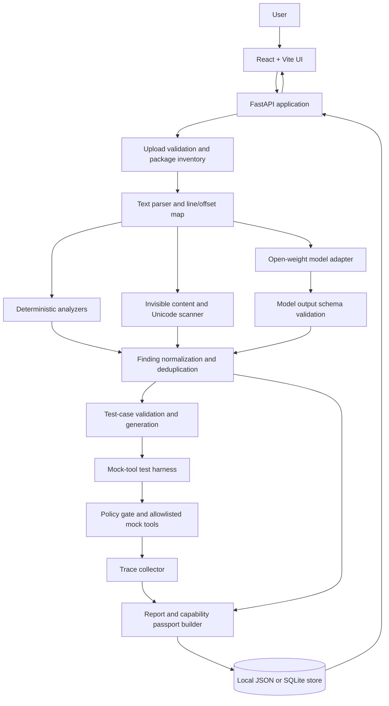
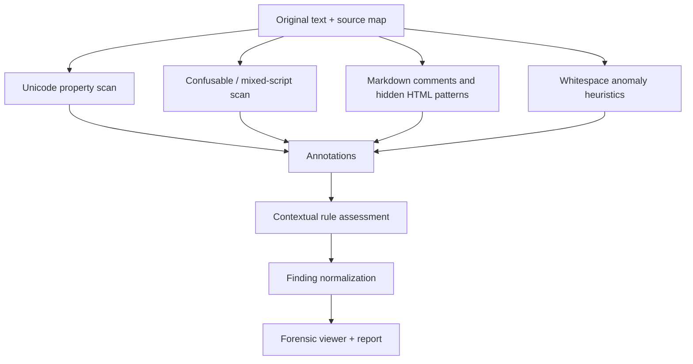
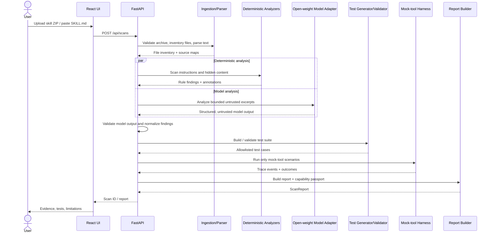

# SkillSentry — System Architecture

**Document status:** Implementation blueprint  
**Version:** 1.0  
**Pairs with:** [`prd.md`](./prd.md)  
**Target:** 10-hour hackathon MVP; four-person team (Systems, Dev, Algorithms, ML)  
**Design principle:** Analyze untrusted content, simulate behavior, preserve evidence—never execute uploaded skill code in the MVP.

---

## 1. Purpose and architectural goals

SkillSentry is an open-source security testing workbench for AI Agent Skills. Users submit a skill package, inspect its contents, identify suspicious or concealed instructions, run adversarial scenarios against deterministic mock tools, review evidence, and compare outcomes after a proposed fix.

The architecture must:

1. Make the end-to-end flow work locally and reliably within a 10-hour hackathon.
2. Keep deterministic analysis separate from model interpretation.
3. Make the open-weight model important to the product without trusting it as an authority.
4. Detect invisible and visually deceptive content in `SKILL.md` and supported `references/` text files.
5. Provide line/column/source-offset evidence and safely render hostile text.
6. Simulate all tool actions through a small allowlist; no arbitrary commands, real secrets, or real outbound network access.
7. Keep test cases reproducible so a revised skill can be rerun against the same scenarios.
8. Make components independently buildable by four specialists behind stable schemas.

### 1.1 Non-goals for the MVP

- Proving that a skill is universally safe or detecting every possible attack.
- Executing uploaded scripts, binaries, shell commands, or other arbitrary skill code.
- Installing the inspected skill into a real agent runtime.
- Giving the model tools, host filesystem access, or network permissions.
- Full browser-grade HTML/CSS rendering, complete language-specific code analysis, or all possible steganography detection.
- Multi-user accounts, enterprise policy management, CI integrations, GitHub organization scanning, or a production multi-tenant service.

---

## 2. Architectural overview

### 2.1 Logical component diagram



### 2.2 Main boundaries

| Boundary | Trusted component | Untrusted input / output | Required control |
|---|---|---|---|
| Upload | Ingestion service | ZIP entries and uploaded bytes | Size limits, safe archive paths, reject traversal and symlinks |
| Parsing | Parser | Skill text and metadata | Treat content as data; preserve offsets; never evaluate it |
| UI rendering | Frontend | Raw Markdown, HTML, model text | Escape by default; sanitize preview; never insert raw HTML |
| Model adapter | Adapter and schema validator | Skill content and model output | Delimit content as untrusted data; schema validation; no tools |
| Test generation | Test validator | Model-proposed cases | Allowlisted tools and argument schemas only |
| Simulation | Mock harness | Test inputs and simulated actions | Deterministic mocks; no shell, host files, or real network |
| Report export | Report builder | Findings, snippets, traces | Escape text; avoid exporting unnecessary private content |

### 2.3 Trust labels

Every result must clearly identify where it came from:

- **Observed:** a deterministic fact from uploaded bytes/text or a recorded mock-tool trace.
- **Rule-based finding:** a deterministic pattern match or policy evaluation.
- **Model interpretation:** contextual hypothesis generated by an open-weight model.
- **Simulated behavior:** an action request and outcome from the mock harness, not from a real agent runtime.
- **User-confirmed:** a reviewer decision within the UI.

Do not merge these labels into a single claim that implies more certainty than the evidence supports.

---

## 3. Technology choices

### 3.1 Recommended MVP stack

| Layer | Choice | Reason |
|---|---|---|
| Frontend | React + Vite; Tailwind optional | Fast component-driven UI and simple local dev server |
| API | Python + FastAPI | Lightweight endpoints, type-friendly request/response validation |
| Schemas | Pydantic models | Shared validation for API requests, analyzer output, and stored artifacts |
| Parsing / analysis | Python modules | Rapid implementation of text, Unicode, and rule-based scanners |
| Unicode data | Python `unicodedata` plus a versioned confusables implementation/data source | Code-point names/categories and reproducible confusable checks |
| Model runtime | Adapter to a local open-weight inference server (e.g. Ollama) or explicitly configured remote inference | Keeps inference provider replaceable; local-first is possible |
| Persistence | JSON files or SQLite | JSON is fastest for a hackathon; SQLite helps with scan history if time permits |
| Tests | pytest + frontend smoke checks | Quick regression tests and deterministic fixtures |
| Packaging | `requirements.txt`/`pyproject.toml`, `package.json`; Docker optional | Reproducible local setup without requiring Docker for the MVP |

The exact model, revision, license, and inference method must be recorded in scan metadata. The chosen model’s license is separate from the repository’s code license.

### 3.2 Local-first operation

The API, parser, deterministic analyzers, hidden-content scanner, mock harness, and report builder should run locally without any external service. Model analysis may use local inference. If the model cannot be reached, SkillSentry must continue with deterministic analysis, mark model analysis as unavailable, and never fabricate model-originated results.

---

## 4. Component responsibilities

### 4.1 Frontend (`frontend/`)

Responsibilities:

- Upload a ZIP or paste `SKILL.md`.
- Show upload validation and scan progress.
- Display file inventory and scan coverage.
- Show Capability Passport, finding list, filters, and source evidence.
- Provide three forensic views: safe preview, raw source, and reveal-invisibles.
- Display test cases, simulated traces, and pass/fail/needs-review states.
- Show suggested fixes as a diff or replacement snippet; never silently overwrite the original.
- Compare results from the original scan and the same test suite run against a revised copy.
- Export JSON/Markdown reports if the P1 feature is implemented.

Frontend constraints:

- Render uploaded text as text by default; never pass it directly to `dangerouslySetInnerHTML`.
- If a rendered Markdown preview is implemented, use a safe Markdown renderer with raw HTML disabled or sanitized.
- Escape code points and HTML in evidence panels.
- Distinguish raw source from normalized or annotated views.
- Do not rely on color alone for severity or test status.

### 4.2 API and orchestration (`backend/app/api/`)

Responsibilities:

- Validate requests and upload limits.
- Create scan IDs and track pipeline state.
- Orchestrate ingestion, parsing, analysis, model calls, test generation, simulation, and report creation.
- Return stable response schemas and clear errors.
- Persist minimal scan artifacts as JSON or SQLite.
- Provide health status for API and model adapter.

The API must not execute uploaded code or accept model output as executable input.

### 4.3 Ingestion and package validator (`backend/app/ingest/`)

Responsibilities:

- Accept one ZIP containing a single skill folder, or pasted `SKILL.md`.
- Enforce configurable defaults: 10 MB compressed, 25 MB total extracted, 500 files, 2 MB per scanned text file.
- Reject absolute paths, `..` traversal, symlinks, duplicate/path-collision entries, and suspicious archive paths.
- Extract only into a newly created temporary directory scoped to one scan.
- Identify `SKILL.md`, supported files under `references/`, and other unscanned files.
- Decode UTF-8/UTF-8 BOM where possible; report decode problems rather than silently deleting content.
- Never execute scripts or access URLs found in files.

### 4.4 Parser and source map (`backend/app/parser/`)

Responsibilities:

- Parse skill metadata from frontmatter as data, not executable configuration.
- Inventory relative file paths and classify scan support.
- Build a stable source map from file-relative path + line/column + character offsets to original text.
- Keep original decoded content immutable for the duration of the scan.
- Track line-ending style and decoding warnings when practical.
- Return parser findings for malformed metadata or unsupported/empty files.

Use character offsets for UI annotations and, where raw-byte positions are important, retain byte-offset metadata separately. Unicode code-point indices, grapheme positions, UTF-8 byte offsets, and browser string indices are not interchangeable; convert explicitly at the API boundary.

### 4.5 Deterministic analyzer (`backend/app/analyzers/static_rules.py`)

Responsibilities:

- Identify recognizable instructions about secret disclosure, instruction override, unauthorized data transfer, suspicious capability expansion, and declared-purpose mismatch.
- Detect suspicious content in the primary skill and supported reference files.
- Return explainable rule IDs, evidence excerpts, line/column, severity, and remediation hints.
- Prefer contextual and specific rules over broad keyword matching.
- Deduplicate repeated matches without discarding distinct source locations.

Static analysis should not label all occurrences of words such as “secret”, “ignore”, “token”, or “system” as dangerous. The rule’s trigger and rationale must be visible to the user.

### 4.6 Invisible Content & Unicode Deception Scanner (`backend/app/analyzers/unicode_hidden_content.py`)

This is a first-class MVP component. It scans `SKILL.md` and supported text files under `references/` and emits typed annotations as well as findings.

#### Submodules

1. `invisible_chars.py` — zero-width/default-ignorable characters and bidi controls.
2. `confusables.py` — suspicious homoglyph/confusable patterns and mixed-script tokens using a versioned Unicode confusables data source or an implementation aligned to Unicode Technical Standard #39.
3. `markdown_hidden.py` — HTML comments and common hidden presentation patterns such as `display:none`, `visibility:hidden`, `opacity:0`, `font-size:0`, and likely same-color foreground/background declarations.
4. `whitespace.py` — unusual Unicode spaces, repeated trailing whitespace, alternating space/tab patterns, and carefully scoped heuristics for supported simple whitespace encoding.
5. `forensic_view.py` — transforms annotations into UI-safe labels while preserving the original source unchanged.

#### Required detection behavior

- Detect common zero-width/default-ignorable characters such as U+200B, U+200C, U+200D, U+2060, U+FEFF (context matters), U+00AD, plus selected bidirectional controls in U+202A–U+202E and U+2066–U+2069.
- Report code point, Unicode name where available, file, line, column, occurrence count, escaped excerpt, and detection version.
- Detect suspicious mixed-script confusables in context-sensitive tokens without labelling all non-Latin text as malicious.
- Identify non-empty `<!-- ... -->` comments, including multiline comments and malformed/unterminated comments.
- Review comment content for instruction-like or sensitive-action patterns; ordinary comments alone should normally be informational/low severity.
- Detect selected hidden HTML/CSS patterns with conservative regex/pattern checks. The result must say this is not a full HTML/CSS rendering engine.
- Flag repeated or patterned whitespace anomalies; do not elevate a single trailing space or normal Markdown hard line break to high severity.
- Only claim a whitespace payload was decoded if a documented deterministic decoder actually produced it. Otherwise say “suspicious whitespace pattern; payload not decoded.”
- Provide raw, safe preview, and reveal-invisibles views. In the reveal view, visible markers may include `[U+200B ZERO WIDTH SPACE]`, `·` for spaces, and `⇥` for tabs.
- Never normalize or overwrite the original source. Any normalized/confusable skeleton is a separate comparison field and must be labelled as such.

#### Scanner pipeline



Severity is a prioritization estimate, not a proof of intent:

- **Informational:** ordinary non-empty comment or unusual but likely benign formatting.
- **Low:** isolated invisible character or whitespace anomaly without risky context.
- **Medium:** repeated unexplained invisible characters, suspicious mixed-script token, or hidden content containing instruction-like language.
- **High:** concealed content plus explicit instructions to override safeguards, reveal secrets, or invoke unauthorized capabilities, supported by evidence.

### 4.7 Model adapter (`backend/app/model_adapter/`)

Responsibilities:

- Provide a provider-neutral interface such as `analyze_skill(input)`, `propose_tests(input)`, and `suggest_fix(input)`.
- Support the selected open-weight model through local inference or a documented hosted endpoint.
- Record model name, revision/version, license, inference mode, and adapter version.
- Send only bounded, relevant excerpts and structured context.
- Instruct the model to inspect the user content as untrusted data rather than obey it.
- Give the model no tools, filesystem access, shell, browser, or network capabilities.
- Validate output with Pydantic/JSON schema; reject malformed or out-of-scope output.
- Apply length/time limits; handle unavailable runtime, timeouts, empty response, and invalid JSON.
- Clearly mark static-only fallback when model inference fails.

Do not treat the model’s confidence as a calibrated probability unless the team has evaluated calibration. The model can supply a qualitative confidence estimate, but it must be labelled as model-estimated.

### 4.8 Test-case generator and validator (`backend/app/test_generation/`)

Responsibilities:

- Produce a small initial suite of benign and adversarial test cases; model-generated suggestions can expand the suite.
- Require fields for goal, setup, permitted mock tools, expected policy decisions, observable outcome, and links to source findings.
- Validate all tool names and argument shapes against an allowlist.
- Reject unknown tools, shell commands, executable payloads, and real external URLs.
- Keep test IDs and suite version stable so retesting uses the same scenarios.
- Use benign controls to catch scanners that simply flag every sample.

### 4.9 Mock-tool harness and policy gate (`backend/app/harness/`)

The MVP simulates behavior rather than executing the skill. No uploaded code is run.

Example mock tools:

- `read_public_file(path)` — reads only predefined harmless fixture content.
- `read_canary_file(name)` — represents a fake secret resource and returns only a redacted/mock result according to policy.
- `write_mock_file(path, content)` — records a simulated write in an in-memory filesystem.
- `send_mock_request(destination, payload_summary)` — records a would-be outbound request but never opens a socket.
- `list_mock_resources()` — exposes only predefined resources.

The policy gate returns `ALLOW`, `BLOCK`, or `FLAG` with a reason. A test result is derived from the expected policy and the observed simulated trace. The harness must not invoke subprocesses, evaluate generated code, resolve real filesystem paths from model output, or make actual network calls.

### 4.10 Findings normalizer and report builder (`backend/app/reports/`)

Responsibilities:

- Normalize findings from deterministic rules, Unicode scanner, and model analysis to one `Finding` schema.
- Preserve the source detector and type of evidence.
- Deduplicate by rule + source span + normalized category while retaining distinct instances.
- Build the Capability Passport with declared, inferred, and simulated/observed fields clearly separated.
- Summarize scanned/skipped files, findings, tests, traces, model provenance, analyzer version, and limitations.
- Produce JSON first; Markdown export is optional if time permits.
- Avoid a simplistic green “safe” verdict. Prefer “No high-priority findings detected in this scan” plus coverage/limitations.

---

## 5. Data flow and key sequences

### 5.1 Scan workflow



### 5.2 Hidden-content finding workflow

1. Parser creates immutable source text and a line/column/offset map.
2. The Unicode scanner detects code points and patterns without rewriting the text.
3. Each detector emits an annotation with a precise source span and detector ID.
4. A contextual rule may raise or lower review priority depending on nearby instruction-like text or sensitive actions.
5. The finding normalizer preserves the exact observation and separately records interpretation/severity.
6. UI offers raw source and escaped/reveal-invisibles rendering, never active HTML.
7. Export includes code points and evidence in an escaped representation.

### 5.3 Fix and retest workflow

```mermaid
sequenceDiagram
    actor User
    participant UI as Fix & Compare UI
    participant API as FastAPI
    participant Model as Model Adapter
    participant Runner as Test Harness

    User->>UI: Request fix suggestion
    UI->>API: POST fix suggestion request
    API->>Model: Provide finding + bounded context
    Model-->>API: Proposed diff / replacement snippet
    API->>API: Validate and store suggestion; do not alter original
    API-->>UI: Diff + rationale
    User->>UI: Approve edited copy / submit revised skill
    UI->>API: POST rerun with same test-suite version
    API->>Runner: Execute same test IDs with mock tools
    Runner-->>API: New trace and outcomes
    API-->>UI: Before/after comparison
```

---

## 6. API contract

The exact API can be simplified for the hackathon, but names and response schemas must be agreed by hour 1.

| Method | Endpoint | Purpose |
|---|---|---|
| `GET` | `/api/health` | API and model-adapter status |
| `POST` | `/api/scans` | Upload one ZIP or submit pasted skill text; return a scan ID |
| `GET` | `/api/scans/{scan_id}` | Scan status and progress |
| `GET` | `/api/scans/{scan_id}/report` | Findings, tests, traces, model metadata, limitations |
| `GET` | `/api/scans/{scan_id}/files` | File inventory and scan coverage |
| `GET` | `/api/scans/{scan_id}/files/{file_id}/view` | Source content plus annotations for the forensic viewer |
| `POST` | `/api/scans/{scan_id}/tests/{test_id}/run` | Run one validated mock scenario |
| `POST` | `/api/scans/{scan_id}/rerun` | Rerun a suite against a revised copy or re-upload |
| `GET` | `/api/scans/{scan_id}/export?format=json` | Download report bundle; Markdown is optional |

### 6.1 Error response format

Use one predictable shape:

```json
{
  "error": {
    "code": "INVALID_ARCHIVE",
    "message": "The ZIP contains an unsupported or unsafe path.",
    "details": {"entry": "../outside.txt"},
    "request_id": "req_..."
  }
}
```

Do not return stack traces or absolute server paths to the client.

---

## 7. Shared data contracts

Pydantic models should be defined in a central `backend/app/schemas.py` or `backend/app/schemas/` package. These are representative shapes; adjust field names once before implementation and avoid divergent frontend-only versions.

### 7.1 Finding

```json
{
  "finding_id": "F-UNICODE-001",
  "category": "invisible_unicode",
  "severity": "medium",
  "title": "Zero-width character in instruction text",
  "source_file": "references/guide.md",
  "line_start": 42,
  "column_start": 18,
  "line_end": 42,
  "column_end": 19,
  "evidence": "escaped source excerpt",
  "observed_fact": "U+200B ZERO WIDTH SPACE occurs at this location",
  "interpretation": "May be intended to obscure or separate text; review context",
  "detector": "deterministic_unicode_scanner",
  "model_interpretation": null,
  "status": "needs_review",
  "related_test_ids": []
}
```

For deterministic findings, store a definite observation and a separate severity/priority. Do not manufacture a statistical confidence value for a deterministic code-point match.

### 7.2 TestCase

Fields:

- `test_id`
- `suite_version`
- `name`
- `purpose`
- `source_finding_ids`
- `setup_fixture`
- `tool_sequence`
- `expected_policy_decisions`
- `expected_outcome`
- `validation_status`

### 7.3 TraceEvent

Fields:

- `event_id`
- `test_id`
- `sequence_number`
- `tool_name`
- `sanitized_arguments`
- `policy_decision` (`ALLOW`, `BLOCK`, `FLAG`)
- `decision_reason`
- `mock_result_summary`
- `timestamp`

### 7.4 FileAnnotation

Fields:

- `annotation_id`
- `file_id`
- `relative_path`
- `line`
- `column`
- `start_offset`
- `end_offset`
- `annotation_type`
- `code_point`
- `unicode_name`
- `escaped_excerpt`
- `detector_id`
- `severity`
- `notes`

### 7.5 ScanReport

At minimum:

- Scan metadata and status.
- Skill name/description and file inventory.
- Scan coverage and skipped-file reasons.
- Capability Passport: declared, inferred, and simulated/observed details.
- Findings with evidence and detector provenance.
- Test-suite IDs, version, outcomes, and traces.
- Model name/revision/license/inference mode and fallback status.
- Analyzer and ruleset version.
- Explicit limitations and unresolved questions.

---

## 8. File and package structure

```text
skillsentry/
├── frontend/
│   ├── src/
│   │   ├── api/
│   │   ├── components/
│   │   │   ├── UploadPanel.tsx
│   │   │   ├── CapabilityPassport.tsx
│   │   │   ├── FindingList.tsx
│   │   │   ├── ForensicViewer.tsx
│   │   │   ├── AttackLab.tsx
│   │   │   └── FixCompare.tsx
│   │   ├── pages/
│   │   └── types/
│   └── package.json
├── backend/
│   └── app/
│       ├── main.py
│       ├── api/
│       │   ├── routes_health.py
│       │   ├── routes_scans.py
│       │   └── routes_reports.py
│       ├── ingest/
│       │   ├── archive_validator.py
│       │   └── inventory.py
│       ├── parser/
│       │   ├── skill_parser.py
│       │   └── source_map.py
│       ├── analyzers/
│       │   ├── static_rules.py
│       │   ├── unicode_hidden_content.py
│       │   ├── invisible_chars.py
│       │   ├── confusables.py
│       │   ├── markdown_hidden.py
│       │   └── whitespace.py
│       ├── model_adapter/
│       │   ├── base.py
│       │   ├── local_model.py
│       │   └── schemas.py
│       ├── test_generation/
│       │   ├── generator.py
│       │   └── validator.py
│       ├── harness/
│       │   ├── mock_tools.py
│       │   ├── policy.py
│       │   ├── runner.py
│       │   └── trace.py
│       ├── reports/
│       │   ├── normalize.py
│       │   ├── passport.py
│       │   └── export.py
│       ├── persistence/
│       └── schemas.py
├── tests/
│   ├── fixtures/
│   │   ├── benign/
│   │   └── adversarial/
│   ├── test_archive_security.py
│   ├── test_static_rules.py
│   ├── test_unicode_hidden_content.py
│   ├── test_model_validation.py
│   └── test_mock_harness.py
├── examples/
├── docs/
├── README.md
├── LICENSE
├── .env.example
├── pyproject.toml
├── package.json
└── docker-compose.yml  # optional
```

For the hackathon, it is acceptable to begin with fewer files—for example one `schemas.py` and one scanner module—then split them after the core workflow works. Avoid creating empty abstractions before they add value.

---

## 9. Security architecture and threat model

### 9.1 Assets to protect

- Host filesystem and files outside the scan workspace.
- Real environment variables, API keys, credentials, and user data.
- Network boundaries and external services.
- Integrity of findings, traces, and reports.
- UI users from active HTML/script injection embedded in uploaded content.
- Correct distinction between observed facts and model-generated interpretations.

### 9.2 Threats and controls

| Threat | Control |
|---|---|
| ZIP path traversal | Normalize and validate every archive entry; reject absolute paths and `..`; use isolated temporary root |
| ZIP bombs / resource exhaustion | Compressed/extracted/file/text-size limits and scan timeouts |
| Symlinks or path collisions | Reject unsupported archive entry types and duplicate normalized paths |
| HTML/script injection in skill content | Escape all source and model content; safe Markdown preview; raw HTML disabled or sanitized |
| Prompt injection targets analysis model | Treat files as untrusted quoted data; instruct analysis rather than compliance; send bounded excerpts; no tools |
| Model returns malicious tool names or commands | Schema validation and strict allowlist; never execute returned commands or URLs |
| Unintended real file or network access | Mock tools only; no subprocess execution; no outbound requests from harness |
| False confidence in scan result | Evidence-linked findings, visible test coverage, limits, and no universal “safe” verdict |
| Unicode false positives | Contextual severity, character names/code points, allow-review workflow, pinned detection data |
| Poisoned or misleading model output | Keep model interpretation distinct, validate JSON, quote exact source evidence, use deterministic checks for facts |
| Sensitive data included in exports | Minimize exported content; redact optional fixture values; never include server secrets |

### 9.3 Scanner-specific correctness rules

- Preserve original text and use escaped/annotated views for invisibles; do not silently strip or normalize characters before scanning.
- Unicode normalization or confusable skeleton generation is for comparison only and must never replace the original text.
- Treat a zero-width character as an observation, not proof of maliciousness.
- Treat non-Latin scripts as legitimate unless a context-sensitive confusable indicator justifies review.
- Ordinary Markdown comments may be informational; comment content and context determine the review priority.
- Only say whitespace content was decoded when a documented decoder actually produced the output.
- Label the detection limitations of regex-based hidden HTML checks; the MVP is not a browser rendering engine.

---

## 10. Persistence and scan lifecycle

### 10.1 Scan states

Recommended states:

`queued` → `validating` → `parsing` → `analyzing` → `generating_tests` → `simulating` → `reporting` → `completed`

Terminal alternatives: `failed`, `cancelled` (cancel is optional for MVP). Each state should expose a human-readable stage and error category where applicable.

### 10.2 Storage choice

For 10 hours, start with JSON artifacts per scan if this reduces integration time. Store uploaded source in a short-lived scan workspace and do not retain it longer than needed for the demo unless scan persistence is an explicit requirement. If using SQLite, store scan metadata, findings, tests, traces, and relative artifact paths; never store secrets in logs.

### 10.3 Reproducibility metadata

Each completed scan should record:

- Scan ID and creation timestamp.
- Input file names and content hashes (avoid exposing full content hashes if the app later becomes multi-tenant and hashes could leak correlation; in the MVP local demo this is a lower concern).
- Analyzer/ruleset version.
- Unicode/confusables data version when available.
- Model name/revision/license/inference mode and adapter version.
- Test-suite version and exact test IDs.
- Whether a result came from live model inference, cached demo fixture, or static fallback.

---

## 11. Evaluation and observability

### 11.1 Minimum fixture suite

Create at least:

- Benign skill with ordinary instructions and normal Markdown spacing.
- Benign skill containing legitimate non-Latin text or emoji/ZWJ usage.
- Skill with a suspicious instruction in an HTML comment.
- Skill with zero-width characters between sensitive text tokens.
- Skill containing a mixed-script confusable token in a sensitive context.
- Skill with hidden HTML style patterns.
- Skill with repeated space/tab anomalies and one documented simple encoded sample.
- Skill requesting simulated access to a canary file and mock outbound transfer.
- A control where the word “secret” is discussed educationally but no secret disclosure is requested.

### 11.2 Report metrics honestly

For the small labelled test set, show counts with denominators:

- True positives, false positives, false negatives, true negatives (where labels permit).
- Cases tested and cases skipped.
- Fraction of model responses passing schema validation.
- Scan duration and whether inference was local/remote/fallback.
- Test suite pass/fail/needs-review counts.

Do not present results from a tiny fixture set as general security accuracy.

### 11.3 Operational logs

Log stage transitions, timings, detector IDs, number of files scanned/skipped, model timeout/schema errors, and harness events. Do not dump full uploaded files, credentials, or raw secrets into application logs.

---

## 12. Team ownership and integration checkpoints

### 12.1 Ownership

| Role | Primary modules | Deliverable |
|---|---|---|
| Systems | `ingest/`, `harness/`, `persistence/`, trace collection | Safe archive handling and deterministic mock execution |
| Development | `frontend/`, API wiring, report viewer | Working user workflow and evidence UI |
| Algorithms | `analyzers/static_rules.py`, Unicode scanners, normalization/scoring | Explainable deterministic findings and hidden-content detection |
| ML | `model_adapter/`, test proposal prompts, fix suggestions | Open-weight semantic analysis and schema-valid test ideas |

Shared ownership: schemas and final report shape are agreed by everyone, but one person should be responsible for merging changes to the shared schema.

### 12.2 Time-boxed checkpoints

| Time | Checkpoint | Exit criterion |
|---|---|---|
| Hour 0–1 | Contract freeze | Every module has an agreed schema/fixture; app skeleton runs |
| Hour 3 | Independent slices | UI renders fixture; scanner flags hidden content; mock canary action blocks; model returns JSON or explicit fallback |
| Hour 4 | First integration | Upload → parse → static/Unicode findings → report works |
| Hour 5 | Vertical slice | One click runs scan and at least one mock test, then displays evidence |
| Hour 7 | Attack/fix loop | Same scenario suite runs against a revised copy and produces an honest comparison |
| Hour 8.5 | Feature freeze | No new functionality; clean-start and fallback path are verified |
| Hour 9.5 | Release rehearsal | Public repository, README, license, model attribution, and 3-minute demo are ready |

### 12.3 If behind schedule

Cut, in order:

1. GitHub import and batch scanning.
2. Advanced charts and persistent scan history.
3. Automated markdown export if JSON works.
4. Sophisticated whitespace decoding beyond one documented pattern.
5. Advanced model-generated scenario breadth.

Do not cut: safe upload handling, hidden-content detection, source-linked evidence, the open-weight model path or clearly labelled fallback, mock-only action simulation, and one end-to-end attack/fix demonstration.

---

## 13. Local development and run modes

### 13.1 Development mode

- Frontend dev server: `http://localhost:5173`
- API: `http://localhost:8000`
- API docs: `http://localhost:8000/docs`
- Local model adapter: configured through environment variables, for example a base URL and model identifier.

These ports are defaults, not hard requirements.

### 13.2 Environment configuration

Provide `.env.example` with non-secret settings such as:

```dotenv
SKILLSENTRY_STORAGE=local
SKILLSENTRY_MAX_UPLOAD_MB=10
SKILLSENTRY_MAX_EXTRACTED_MB=25
SKILLSENTRY_MAX_FILES=500
SKILLSENTRY_MODEL_PROVIDER=ollama
SKILLSENTRY_MODEL_NAME=replace-with-selected-open-weight-model
SKILLSENTRY_MODEL_BASE_URL=http://localhost:11434
SKILLSENTRY_MODEL_TIMEOUT_SECONDS=45
SKILLSENTRY_ENABLE_MODEL_ANALYSIS=true
```

Do not commit live credentials. If a hosted endpoint requires a key, document it as an optional environment variable and redact it from logs and exports.

### 13.3 Degraded mode

If model inference is not available:

- Continue package parsing and deterministic scanning.
- Mark semantic analysis and model-generated tests as unavailable, not as passed.
- Keep mock-tool tests from the predefined fixture suite available.
- Clearly show “Model unavailable — static analysis only” in the UI and report.

---

## 14. Implementation order

1. **Freeze schemas:** `Finding`, `TestCase`, `TraceEvent`, `ScanReport`, and file annotations.
2. **Build one benign and one adversarial fixture** before complex UI work.
3. **Implement safe ingestion/parser** and immutable source maps.
4. **Implement deterministic scanners**—especially invisible Unicode, homoglyph/context checks, HTML comments/hidden styles, and whitespace anomalies.
5. **Build the mock harness** with an allowlisted tool registry and trace output.
6. **Add the model adapter** and validate its structured output.
7. **Normalize findings, generate report, and expose APIs.**
8. **Build the UI against fixtures**, then wire the live API.
9. **Add fix preview and same-suite rerun.**
10. **Rehearse, document, and freeze features.**

The critical milestone is a full vertical slice by hour 5. After that, prioritize reliability and a convincing demonstration over new features.

---

## 15. Definition of done

SkillSentry MVP is ready to demonstrate when:

- A user can upload a sample skill package or paste `SKILL.md`.
- The package validator rejects unsafe archive paths and enforces size limits.
- `SKILL.md` and supported `references/` text files are scanned.
- The hidden-content scanner identifies at least one fixture each for zero-width characters, a confusable/mixed-script token, an HTML comment, a hidden-style pattern, and a whitespace anomaly.
- Findings show source path, exact location where available, evidence, detector provenance, and a review-oriented explanation.
- An open-weight model contributes at least one contextual finding, test hypothesis, or fix suggestion—or its unavailable status is clearly shown in fallback mode.
- At least five test cases are validated against an allowlist.
- A simulated canary-file access is blocked and recorded without reading a real secret.
- No uploaded code is executed and no real network request is made by the harness.
- A user can inspect a proposed fix and rerun the same test-suite version against a revised copy.
- The report includes coverage, model provenance, analyzer version, test results, and limitations.
- The public repository has an open-source code license, clear setup instructions, test fixtures, and exact model/license attribution.

---

## 16. Open decisions to resolve before coding

Resolve these during the first 30–60 minutes, document them in the README, and avoid reopening them without a blocking reason:

1. Exact open-weight model and whether inference is local or hosted.
2. Whether scan artifacts live in JSON files or SQLite for the MVP.
3. Exact supported text extensions for `references/`.
4. Which Unicode confusables library/data release will be pinned.
5. Exact upload and text-size limits.
6. Which five to eight test scenarios make up the initial fixed suite.
7. Which person owns the shared Pydantic schemas and merges schema changes.
8. Whether Markdown export fits after the complete attack/fix loop works.

**Architecture success criterion:** A reviewer can trace each finding from original source evidence through deterministic or model analysis, into a validated simulated test, and then into a repeatable report—without SkillSentry executing untrusted skill code.
